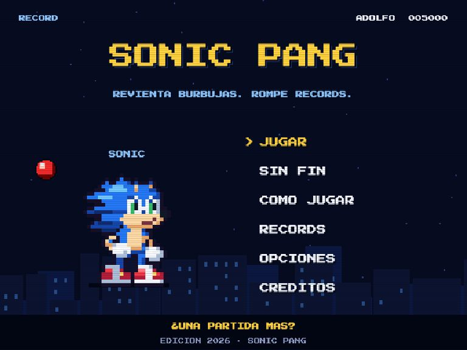
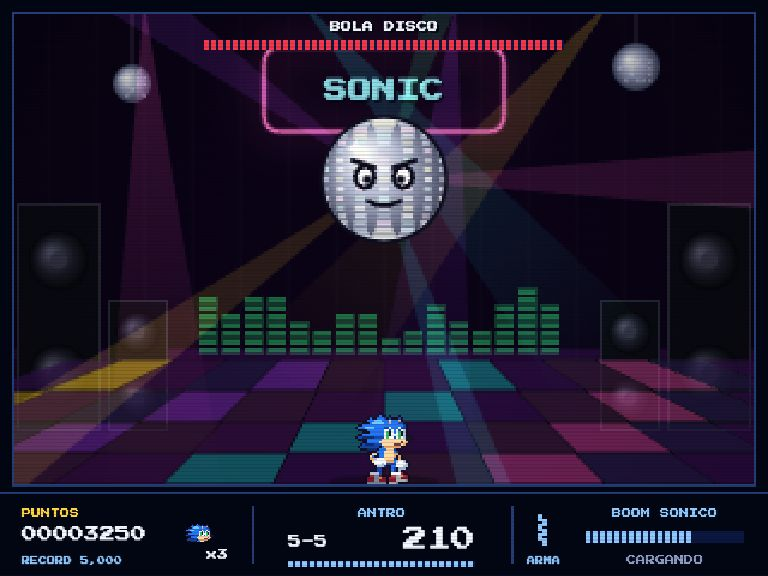

<h1 align="center">SonicPang (Flash Era)</h1>

Recreación del juego SonicPang de la era Flash, con una presentación
arcade de 16 bits hecha con HTML, CSS y JavaScript, Canvas 2D y Web Audio. Incluye
30 niveles, seis mundos, dos jefes y un modo sin fin. No requiere dependencias,
cuentas, servidor de aplicación ni compilación.

<p align="center">
  
  
</p>

[Cómo contribuir](CONTRIBUTING.md) · [Guía visual](design.md) ·
[Licencia MIT](LICENSE) · [Créditos](THIRD_PARTY_NOTICES.md)

Sonic, el erizo azul de guantes blancos y zapatos rojos, recorre seis mundos reventando
las burbujas donde **El Gran Mimo** encerró todos los sonidos del mundo. Cada burbuja
reventada suelta una nota musical, así que mientras mejor juegas, mejor suena.

## Cómo jugar

**La forma más fácil:** abre `index.html` con doble clic. No necesita instalar nada.

**Con servidor local** (Python 3, recomendado para desarrollar y guardar el progreso
en un origen estable; desactiva la caché):

```bash
python3 tools/serve.py
```

Luego abre <http://localhost:8642>.

Puedes elegir otro puerto con `python3 tools/serve.py 8000`. El servidor escucha
únicamente en esta computadora.

> La fuente Press Start 2P se carga desde Google Fonts.
> Sin internet el juego sigue funcionando con fuentes del sistema. La carga de la
> tipografía es la única dependencia de red del juego; no hay analítica ni servicios
> de puntuaciones.

## Controles

| Acción            | Teclado                | Control                  |
|-------------------|------------------------|--------------------------|
| Moverse           | ← → o A D              | Cruceta / stick          |
| Disparar la onda  | Espacio, Z o ↑         | A                        |
| BOOM SÓNICO       | X o Shift              | B                        |
| Pausa             | P, Esc o Enter         | START                    |
| Silenciar música  | M                      |                          |
| Pantalla completa | F                      |                          |

En celular aparecen botones en pantalla. En vertical, el juego queda arriba y los
controles abajo.

## Reglas

- Cada burbuja se parte en dos más chicas al darle; las más chiquitas desaparecen.
- La onda sónica sube desde el piso: todo lo que toque en su camino cuenta.
- **Gemas:** no rebotan como pelotas; viajan en diagonal sin parar.
- **Combos:** si revientas seguido, los puntos se multiplican hasta x8 y las notas suben de tono.
- **Barra SONIC:** se llena al reventar burbujas. Cuando está llena, X lanza el **BOOM SÓNICO**,
  que parte todas las burbujas de la pantalla y daña a los jefes.
- Si una burbuja te toca o se acaba el tiempo, pierdes una vida y el nivel vuelve a empezar.
  Contra un jefe no pierdes el avance: el jefe conserva el daño que le hiciste.
- Vidas extra a los 20,000, 60,000 y 120,000 puntos, y en adelante.

### Ítems

| Ítem        | Efecto                               |
|-------------|--------------------------------------|
| Doble onda  | Dos ondas a la vez                   |
| Onda fija   | La onda se queda pegada al techo     |
| Ráfaga      | Disparo continuo de anillos          |
| Escudo      | Aguanta un golpe                     |
| Reloj       | Congela las burbujas 5 segundos      |
| Arena       | Burbujas en cámara lenta             |
| Dinamita    | Todo se parte en burbujas chiquitas  |
| Batería     | Carga media barra SONIC              |
| 1UP         | Vida extra                           |
| Cassette, CD, vinil y nota dorada | 500, 1,000, 2,000 y 5,000 puntos |

## Modos

- **Aventura:** 30 niveles en 6 mundos (Barrio, Playa, Ciudad, Desierto, Antro y Espacio),
  con la **Bola Disco** como jefe del mundo 5 y **El Gran Mimo** como jefe final. Al terminar
  un mundo se desbloquea el siguiente para empezar desde ahí.
- **Sin fin:** las burbujas caen sin parar y la dificultad sube cada pocas decenas de burbujas.

Los récords (10 por modo), las opciones y el avance se guardan en `localStorage`
(`sonicpang.save.v1`) del navegador. Las tablas iniciales contienen marcas de
muestra. Las actualizaciones conservan las marcas personales. Los datos no se
envían a un servidor ni se sincronizan entre dispositivos. Si el navegador bloquea
el almacenamiento, se puede jugar, pero el progreso no se conservará al cerrar.

## Estructura

```
index.html          página contenedora arcade
css/style.css       página y botones táctiles
css/tokens.css      colores y tipografía de la página
js/core.js          utilidades y guardado (localStorage)
js/input.js         teclado, ratón, táctil y gamepad
js/audio.js         síntesis de efectos y secuenciador chiptune (Web Audio)
js/music.js         canciones originales
js/gfx.js           texto pixelado, menús, barras, bolas e íconos
js/sprites.js       pixel art de Sonic, generado por código
js/backgrounds.js   fondos procedurales de los 6 mundos
js/levels.js        los 30 niveles e ítems
js/entities.js      bolas, gemas, ondas, ítems, jugador y jefes
js/game.js          reglas, colisiones, puntos, HUD y efectos
js/scenes.js        loader, título, historia, menús, récords y final
js/main.js          arranque, bucle de 120 Hz, escalado y transiciones
tests/sim.js        bot que juega los 30 niveles para comprobarlos
tests/store.js      guardado y actualización de los récords iniciales
docs/screenshots/   capturas del menú y de una partida
tools/              servidor, visor de sprites, revisión visual y kit de pruebas
```

El juego dibuja sus gráficos y sintetiza el audio en vivo, sin cargar imágenes
ni archivos de sonido. Las capturas del README están en `docs/screenshots/`.

## Pruebas

Requieren Node.js 24 o posterior. No hace falta ejecutar `npm install`.

```bash
node tests/store.js          # récords iniciales y conservación de marcas guardadas
node tests/sim.js            # bot invencible: cada nivel se puede completar a tiempo
node tests/sim.js --mortal   # bot que esquiva y puede morir (mide la dificultad)
node tests/sim.js --mortal --level 30   # un solo nivel, con la vida del jefe
```

Para revisar las 24 pantallas y el dibujo de los 30 niveles, abre
`tools/arcade-preview.html` desde el servidor local. Este banco visual usa datos
en memoria y no altera los récords ni el progreso del jugador.

La simulación también revisa que ninguna bola se salga del área, se atore dentro de un
bloque o quede inalcanzable, y que el modo sin fin aguante 6 minutos sin errores.
Es una comprobación de lógica con un bot; no sustituye las pruebas de audio,
controles ni compatibilidad en un navegador real. GitHub Actions ejecuta las pruebas
y comprueba la sintaxis en cada push y pull request.

Para depurar en el navegador está `SP.debug` (por ejemplo `SP.debug.play(24)` salta al
jefe del mundo 5 y `SP.debug.god = true` te vuelve invencible). Con `?fps` en la URL se
muestran los cuadros por segundo.

## Publicar el juego

Para alojarlo en un servicio de archivos estáticos basta con subir `index.html`,
`css/` y `js/`. Conserva su estructura de carpetas. No necesitas subir `tests/`,
`tools/`, configuraciones locales ni archivos de Git. Usa HTTPS para disponer de
las funciones del navegador que lo requieren, como el acceso a controles en
algunos navegadores.

## Licencia y créditos

- Inspirado en el juego original de **Crashcool**
- Edición 2026: homenaje al Sonic Pang de la era Flash
- Protagonista: Sonic, adaptado al pixel art del remake
- Villano original: El Gran Mimo

Las aportaciones originales de código y documentación se distribuyen bajo la
[licencia MIT](LICENSE), según el [texto de la licencia](https://opensource.org/license/mit).
Es un proyecto fan no oficial: esa licencia no concede derechos sobre Sonic, Pang
ni otros elementos de terceros. La atribución y la tipografía están documentadas
en [THIRD_PARTY_NOTICES.md](THIRD_PARTY_NOTICES.md).
